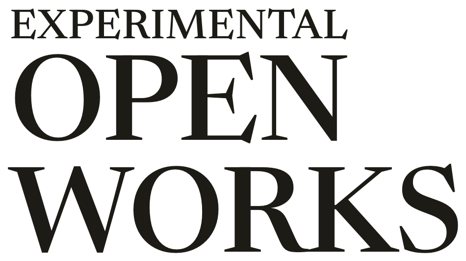

  <picture>
    <source media="(prefers-color-scheme: dark)" srcset="https://raw.githubusercontent.com/Experimental-Open-Works/.github/main/profile/logo-light.png">
    
  </picture>
  <h1>Experimental Open Works</h1>
  
<strong>Research, tools and products for a freer, more open internet.</strong>

  
<a href="https://xowx.org">xowx.org</a>

---

Experimental Open Works researches and builds ways to make technology more free and open. Most of that work ships as free, open-source software, which we release and maintain.

Some projects are alternatives to tools that have ended up behind paywalls, proprietary platforms or closed ecosystems. Others are tools we think should exist, and should be free, so we build them.

## Projects

| Project | What it is | |
|---|---|---|
| **[Let's Seal](https://github.com/letsseal/letsseal)** | A free, open standard for sealing any file (documents, images, email, code and containers) so anyone can prove it is authentic, unaltered and existed by a certain date. Written up as an IETF Internet-Draft. | [letsseal.org](https://letsseal.org) · [source](https://github.com/letsseal/letsseal) |
| **[PCS2](https://pcs2.org)** | A free, open standard for product identity. Makers give every product a permanent address on their own website, with a signed record anyone can check, and the barcode number carried forward for the tills that need it. | [pcs2.org](https://pcs2.org) |
| **[Terminess](https://github.com/Terminess)** | A native Mac terminal and harness for coding agents: Claude Code, Codex, your own API key or a local model, working together, with an iPhone app that follows every agent on every machine. | [terminess.com](https://terminess.com) |
| **[Replen](https://github.com/replenhq)** | A local intelligence layer for AI coding agents: it maps what each of your projects does and surfaces the open-source work worth adopting, porting or learning from. | [replen.dev](https://replen.dev) |
| **[earful](https://earful.cc)** | Records your Meet, Zoom and Teams calls from the Mac menu bar, then writes the transcript and the notes. Free, and your calls stay on your Mac. | [earful.cc](https://earful.cc) |

## Research

- **[Open, With Conditions](https://xowx.org/research/open-with-conditions/)**: the licence of every open-weight AI release from 66 major labs since 2023.
- **[The Binary Switch](https://xowx.org/research/the-binary-switch/)**: how websites govern AI agents, measured.

More at [xowx.org](https://xowx.org).
